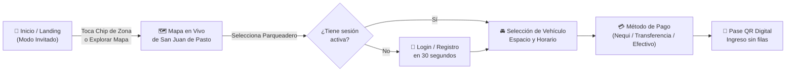

<div align="center">

# 🅿️ Parking Pasto

### Plataforma Inteligente de Movilidad y Reservas de Parqueaderos en San Juan de Pasto

[](https://flutter.dev)
[](https://supabase.com)
[](https://riverpod.dev)
[](https://ai.google.dev)
[](#sistema-de-diseno-apple-hig)

<p align="center">
  <strong>Parking Pasto</strong> conecta en tiempo real a conductores con parqueaderos verificados cerca a centros comerciales, clínicas y hospitales de <strong>San Juan de Pasto, Nariño</strong>. Permite explorar cupos sin registro previo, reservar con pases digitales QR y gestionar espacios e ingresos desde un panel especializado.
</p>

</div>

---

## ✨ Características Principales

<table>
  <tr>
    <td width="50%" valign="top">
      <h3>🚗 Para Conductores</h3>
      <ul>
        <li><strong>Modo Invitado Interactivo</strong>: Explora el mapa de Pasto, filtra por zonas clave y consulta tarifas por hora en COP sin necesidad de crear cuenta hasta el momento de reservar.</li>
        <li><strong>Reservas y Pase QR Dinámico</strong>: Asegura tu cupo para auto o moto y genera un código QR único que se actualiza automáticamente con cada nueva reserva.</li>
        <li><strong>Gestión de Vehículos</strong>: Registra, edita y elimina tus vehículos con protección automática contra eliminación si existen reservas activas o pendientes.</li>
        <li><strong>Cancelación Flexible</strong>: Cancela reservas activas desde tu perfil liberando el cupo en tiempo real.</li>
        <li><strong>Asistente Parking Pasto AI (Gemini)</strong>: Chatbot integrado que recomienda parqueaderos por cercanía, tarifa más económica u horario 24 horas.</li>
      </ul>
    </td>
    <td width="50%" valign="top">
      <h3>🏢 Para Propietarios de Parqueadero</h3>
      <ul>
        <li><strong>Panel de Control en Tiempo Real</strong>: Monitorea la ocupación actual, ingresos del día y estado de cada bahía de estacionamiento.</li>
        <li><strong>Liberación y Gestión de Espacios</strong>: Habilita con un toque los espacios que ya fueron desocupados o márcalos en mantenimiento.</li>
        <li><strong>Calendario y Reservas</strong>: Visualiza la agenda de reservas confirmadas y valida el ingreso de vehículos.</li>
        <li><strong>Control de Pagos y Billetera</strong>: Registra y audita cobros realizados mediante <strong>Nequi</strong>, <strong>transferencia bancaria</strong> o <strong>efectivo</strong>.</li>
        <li><strong>Métricas e Historial</strong>: Gráficas de rendimiento y reportes claros sin intermediarios.</li>
      </ul>
    </td>
  </tr>
</table>

---

## 🗺️ Flujo de Funcionamiento



---

## 📍 Cobertura Georreferenciada en San Juan de Pasto

La plataforma integra **8 puntos estratégicos** de alta afluencia vehicular en Pasto junto con sus parqueaderos aliados verificados:

| Categoría | Punto Clave | Coordenadas (`Lat, Lng`) | Parqueaderos Integrados |
| :--- | :--- | :---: | :--- |
| 🛍️ **Centro Comercial** | **C.C. Unicentro Pasto** | `1.216310, -77.288493` | Parqueadero Unicentro Plaza, Estacionamiento Los Álamos |
| 🛍️ **Centro Comercial** | **C.C. Único Outlet** | `1.205679, -77.259119` | Estacionamiento Único Outlet, Parqueadero Sur Panamericana |
| 🛍️ **Pasaje Comercial** | **Pasaje Nova Centro** | `1.220779, -77.281320` | Parqueadero Pasaje Nova, Parqueadero La Merced Centro |
| 🛍️ **Centro Comercial** | **C.C. Sebastián de Belalcázar** | `1.215818, -77.277940` | Parqueadero Plaza Belalcázar, Estacionamiento San Juan Central |
| 🏥 **Hospital** | **Hospital San Pedro** | `1.224631, -77.292048` | Parqueadero San Pedro Urgencias, Estacionamiento Clínica del Norte |
| 🏥 **Hospital** | **Hospital Infantil Los Ángeles** | `1.223224, -77.280001` | Parqueadero Infantil Los Estudiantes, Estacionamiento Maridíaz Infantil |
| 🏥 **Hospital** | **Hospital Departamental (HUDN)** | `1.204725, -77.268237` | Parqueadero Departamental Salud, Estacionamiento Bolívar HUDN |
| 🏥 **Clínica** | **Clínica Pasto** | `1.216200, -77.284500` | Parqueadero Médica Pasto, Estacionamiento Las Lajas |

---

## 🏗️ Arquitectura del Proyecto

El código sigue **Clean Architecture** combinada con **Riverpod** para inyección de dependencias y estado reactivo:

```text
lib/
├── core/
│   ├── config/          # Variables de entorno (EnvConfig)
│   ├── errors/          # Clases de fallos tipados (AuthFailure, etc.)
│   ├── router/          # Navegación declarativa y guards por rol (GoRouter)
│   ├── theme/           # DesignTokens, AppTheme (Light/Dark) y tipografía
│   └── utils/           # MotionUtils (Física Spring, Haptics, Reduce Motion)
├── data/
│   ├── datasources/     # Catálogo georreferenciado de Pasto y servicio Gemini AI
│   └── repositories/    # Implementaciones Supabase (Auth, Reservas, Vehículos)
├── domain/
│   ├── entities/        # Entidades de negocio (Profile, Vehicle, ParkingLot, UserRole)
│   ├── repositories/    # Contratos de repositorios
│   └── usecases/        # Casos de uso (SignIn, SignUp, SignOut, LogSecurityEvent)
└── presentation/
    ├── auth/            # Login, Registro y onboarding de Vehículo / Parqueadero
    ├── home/            # Landing Apple HIG, Dashboard, Mapa Invitado y Chatbot IA
    ├── profile/         # Perfil persistente con foto de avatar, seguridad y soporte
    ├── vehicles/        # CRUD de vehículos con validación de reservas activas
    └── shared/          # Componentes reutilizables (GlassContainer, AppCard, ZoneChip, etc.)
```

---

## 🎨 Sistema de Diseño (Apple HIG)

La interfaz fue diseñada siguiendo las **Apple Human Interface Guidelines (HIG)** priorizando claridad, contraste **WCAG AA (`>= 4.5:1`)** y fluidez a **60 FPS**:

- **Superficies Liquid Glass (`GlassContainer`)**: Desenfoque `BackdropFilter` controlado con borde translúcido de `1 px` aplicado selectivamente en el header, la barra inferior del CTA y modales flotantes.
- **Física Spring (`AppleSpringCurve`)**: Transiciones basadas en `SpringSimulation`, entrada escalonada (`Fade + Scale 0.96 -> 1.0`), microinteracción táctil inmediata (`scale 0.97` en `< 100 ms`) y feedback háptico contextual (`HapticFeedback`).
- **Light & Dark Mode Semántico**: Paleta adaptativa sin tarjetas blancas fijas en modo oscuro (`#121214` fondo, `#1E1E22` y `#28282E` superficies por elevación, `#FBAB56` acento de marca).
- **Accesibilidad**: Áreas táctiles mínimas de `48x48 dp`, etiquetas `Semantics`, escalado de texto del sistema soportado hasta `1.3x` y respeto automático por la preferencia *"Reducir movimiento"* del dispositivo.

---

## 🔒 Seguridad y Políticas RLS (Supabase)

La base de datos PostgreSQL en Supabase implementa **Row Level Security (RLS)** de privilegio mínimo en las **14 tablas públicas** y en el almacenamiento de archivos (`storage.objects`):

| Recurso | Regla de Acceso (RLS) |
| :--- | :--- |
| `profiles` | Lectura y edición exclusiva del titular (`id = auth.uid()`). Creación protegida por trigger `SECURITY DEFINER` (`handle_new_user`) y bloqueo de escalación de rol (`protect_profile_role`). |
| `vehicles` | `SELECT`, `INSERT`, `UPDATE` y `DELETE` restringidos a `user_id = auth.uid()`. No permite eliminar un vehículo con reservas en estado `pending`, `confirmed` o `active`. |
| `parking_lots` | Lectura pública de parqueaderos `active`; creación y edición exclusiva del propietario (`owner_id = auth.uid() AND is_parking_owner()`). |
| `parking_spaces` / `schedules` | Lectura visible para consulta de disponibilidad; modificación exclusiva del dueño del parqueadero (`owns_parking_lot`). |
| `reservations` / `payments` | Visibles únicamente para el conductor titular de la reserva y el propietario del parqueadero involucrado. |
| `ai_conversations` / `ai_messages` | Historial del chatbot aislado estrictamente por `user_id = auth.uid()`. |
| `security_events` | Bitácora de auditoría insertable únicamente mediante el RPC seguro `log_security_event()`. |
| `storage.objects` (`avatars`) | Bucket privado donde cada usuario solo puede subir, actualizar o borrar su foto dentro de su carpeta `avatars/<auth.uid()>/`. |

---

## 🚀 Instalación y Ejecución

### 1. Requisitos previos
- **Flutter SDK** `^3.10.0`
- Proyecto configurado en **Supabase**
- Clave de API de **Google Gemini** (opcional para respuestas generativas extendidas)

### 2. Configurar variables de entorno
Crea el archivo `env.json` en la raíz del proyecto tomando como plantilla `env.example.json`:

```json
{
  "SUPABASE_URL": "https://tu-proyecto.supabase.co",
  "SUPABASE_ANON_KEY": "tu-supabase-anon-key",
  "OSM_TILE_URL": "https://tile.openstreetmap.org/{z}/{x}/{y}.png",
  "MAP_DEFAULT_LAT": "1.2136",
  "MAP_DEFAULT_LNG": "-77.2811",
  "MAP_DEFAULT_ZOOM": "14.5",
  "DEEP_LINK_SCHEME": "parkingapp",
  "GEMINI_API_KEY": "tu-gemini-api-key"
}
```

### 3. Instalar dependencias y ejecutar

```bash
# Obtener paquetes de Flutter
flutter pub get

# Ejecutar la aplicación inyectando las variables de entorno
flutter run --dart-define-from-file=env.json
```

---

## 🧪 Pruebas y Calidad de Código

El proyecto incluye pruebas unitarias, de widgets, de navegación por roles y de políticas RLS:

```bash
# Análisis estático de código (0 advertencias / 0 errores)
dart analyze

# Ejecutar toda la suite de pruebas automatizadas de Flutter
flutter test
```

---

<div align="center">
  <sub>© 2026 <strong>Parking Pasto</strong> · San Juan de Pasto, Nariño, Colombia.<br/>Movilidad ágil, transparente y segura.</sub>
</div>
